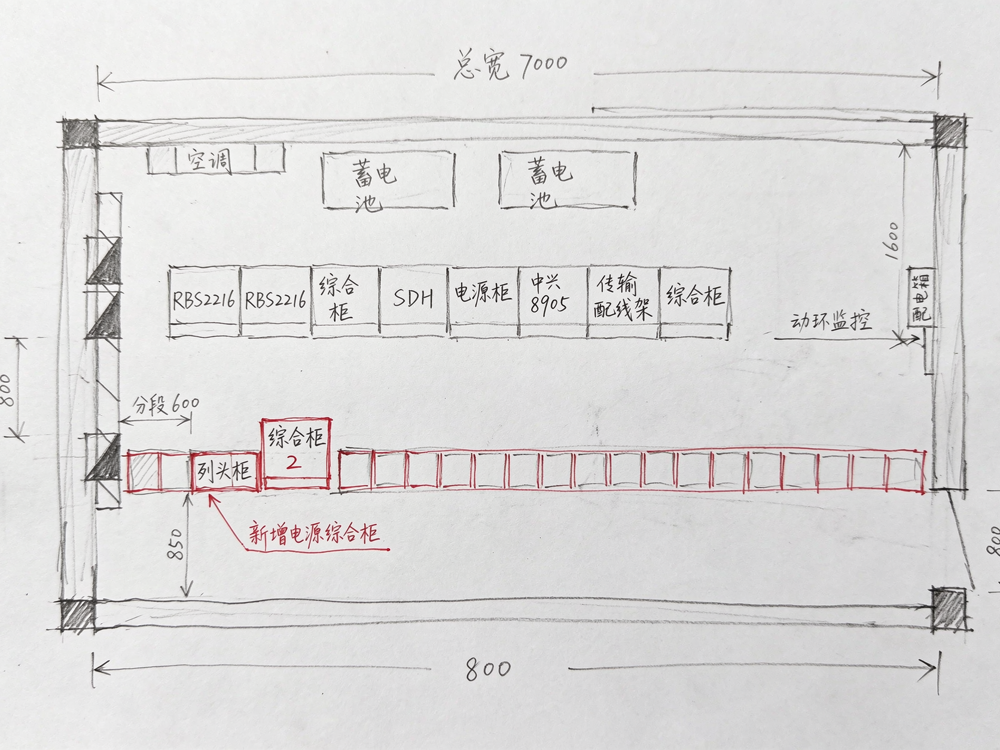
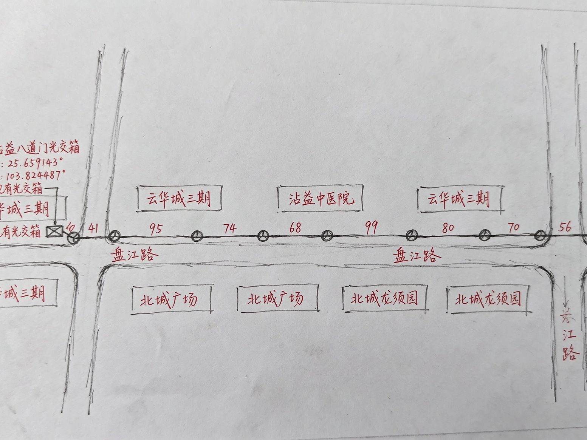
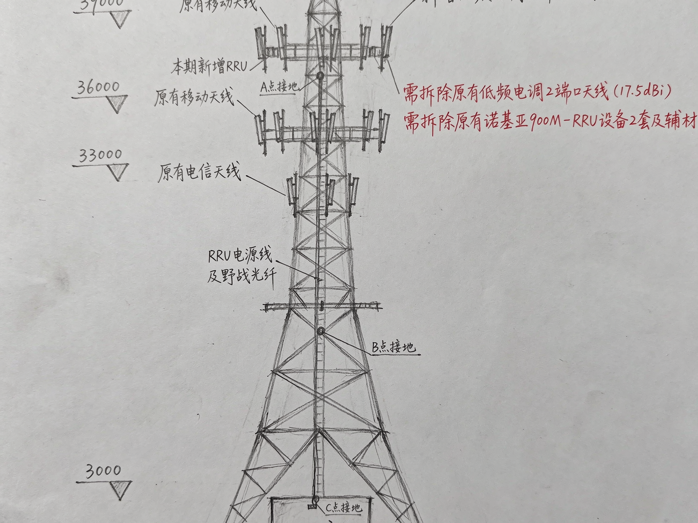

# hand-drawn-sketch · 手绘草图 Skill

> 把通信工程规整图纸，一键转成逼真的现场铅笔手绘草稿。
> 机房布局、光缆线路、天线安装三类图纸专用，单色批注 + 参差手写，信息不丢、尺寸不缺。


---

## 🖼 效果预览

| 机房设备布局草图 | 光缆线路草图 | 无线网天线安装草图 |
| :---: | :---: | :---: |
|  |  |  |

---

## ✨ 特点

- **三类图纸定向覆盖**：机房设备布局平面图、光缆线路 / 路由站点示意图、无线网天线安装图。
- **强制单色批注**：全图只有黑铅笔线稿 + 一种批注色（默认红笔），原图各种彩色统一并入，不杂乱。
- **逼真参差手写**：文字高低错落、基线起伏、大小不一、字距松紧不均，杜绝印刷体和整齐排版。
- **信息保真**：设备/杆路/天线位置、名称编号、尺寸标高、经纬度坐标、线路走向对照原图保留，不遗漏、不颠倒上下游。
- **三档风格可调**：工整笔记体 / 标准草稿（默认）/ 凌乱狂草草稿。
- **现场草稿质感**：手抖线条、重描涂改、圈注问号、纸面灰影与擦痕。
- **线条层级清晰**：主线略粗、标注引线细、箭头简笔；纯线稿不上色块，主动排除写实、3D、光滑数码矢量等观感。

## 🗂 支持的三类图

### 1. 机房设备布局平面图
机柜、电源柜、蓄电池、ODF/DDF、空调、PDF、预留位、柱位等房间内布置；预留虚线框、涂黑柱位、单线墙体。

### 2. 光缆线路 / 路由站点示意图
道路与小区轮廓、杆位圆圈、光交箱、光缆盘留、里程桩、站点经纬度（N/E）、杆距距离、接续标注（如"接下图"）。

### 3. 无线网天线安装图
铁塔 / 抱杆桁架、分层平台、抱杆、天线、RRU、避雷针、机房、接地（A/B/C 点）、倒三角标高、新增 / 拆除设备分类标注。

## 📂 目录结构

```
hand-drawn-sketch/
├── README.md                  # 项目说明（本文件）
├── SKILL.md                   # 技能主文件：流程、强制规则、三类要点、自检清单
├── references/
│   └── prompt-bank.md         # 机房 / 线路 / 天线三套提示词模板 + 迭代短语
└── assets/                    # 预览效果图
```

## 📥 安装

> 一句话：克隆本仓库，把 `hand-drawn-sketch` 整个文件夹复制到所用 AI 智能体的技能目录（Doubao 为 `.user_skills/`），重新加载后上传图纸即可触发。

```bash
git clone https://github.com/Mine1178/hand-drawn-sketch.git
# 将 hand-drawn-sketch 文件夹放入智能体技能目录，重启 / 重新加载技能即可
```

## 🚀 快速使用

1. 在支持 Skill 的 Agent 中加载本技能。
2. 上传一张工程图纸，说明所属类别（机房 / 线路 / 天线）与风格档位。
3. 按 `references/prompt-bank.md` 中对应模板填入本图的柜体、编号、尺寸、坐标等信息，生成手绘草图。
4. 出图后按自检清单核对：单色无杂色、参差手写无印刷体、信息无遗漏。

### 风格档位

| 档位 | 适用场景 | 特征 |
| --- | --- | --- |
| 工整笔记体 | 标注需易读、汇报留档 | 线条较稳，文字清楚，涂改少 |
| 标准草稿（默认） | 一般现场草图 | 自然歪斜重描，潦草参差手写 |
| 凌乱狂草草稿 | 要"越乱越像手绘" | 反复重描、大量擦除涂改、辅助涂鸦多 |

## ⚙️ 强制规则摘要

- **单色**：仅黑铅笔线稿 + 单一批注色；严禁第二种彩色。
- **手写**：参差不成行、大小不一、微歪斜、字距不均；严禁印刷体与整齐排版。
- **保真**：图元位置、名称编号、尺寸 / 标高 / 坐标与原图一致。

## 🧩 兼容与输出

- **兼容**：任何读取 `SKILL.md` 规范的 AI 智能体（Doubao、Claude Code、Codex、GitHub Copilot、Cursor 等）。
- **输出**：单张 PNG 手绘草图；批量图纸逐张生成、逐张交付。
- **输入**：机房布局图、光缆线路 / 路由站点图、天线安装图等规整工程图纸。

## 🤝 贡献

欢迎提 Issue 或 PR：补充新的图纸类型模板、优化提示词、分享样张。如果这个项目对你有用，欢迎点个 Star ⭐。

## 📄 License

MIT License
